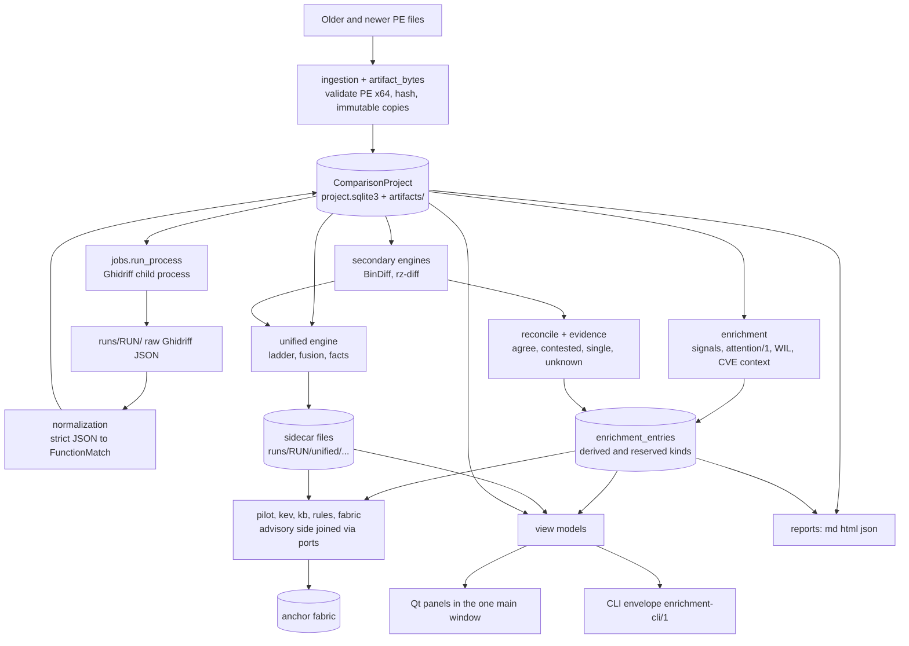

# 20. Architecture

How the code is layered, which modules are pure, where Qt is allowed, and how data flows from two files to a report. Companion documents: `docs/internals.md` (the short map this chapter expands), `docs/modules.md` (per-module rows), `docs/specs/architecture.md` (SPEC-01). User view: [guide index](../guide/00-index.md). Next: [21 data model and storage](21-data-model-and-storage.md).

## Layers

A lower layer never imports a higher one. The rule is enforced by import-isolation tests per package (see "How the layering is enforced").

| Layer | Contents | May import | Examples |
|---|---|---|---|
| 1. Contracts and pure domain | strict, frozen records and pure functions: no I/O, no Qt, no network | stdlib, pydantic | `models.py`, `evidence.py`, `alignment.py`, `normalization.py`, `enrichment/contracts.py`, `*/contracts.py`, `enrichment/identity.py`, `unified/registry.py` |
| 2. Adapters | bounded readers and process or network edges, behind Protocols or injected openers; still no Qt | layer 1, stdlib | `ingestion.py`, `artifact_bytes.py`, `pe_overview/`, `representations/`, `secondary/` (BinExport, BinDiff, rz-diff), `acquisition/transport.py`, `enrichment/intelligence.py`, `providers.py`, `intelligence/tools/`, `jobs.py`, `backend.py` |
| 3. Services and engines | orchestration of 1 and 2; no Qt | layers 1 and 2 | `service.py` (project aggregate), `enrichment/pipeline.py`, `unified/`, `nway/`, `pilot/`, `kbcorrelation/`, `kev/`, `rules/`, `fabric/`, `codetext/`, `symbols/`, `calibration/` (runtime only) |
| 4. Presentation | Qt on the main thread, and the headless CLI | everything below | `ui.py`, `ui_*.py`, `gui/qt/`; `cli.py`, `cli_commands/` (never imports Qt) |

`gui/` (without `qt/`) is a pure layer-1/3 framework: registry, projection, anchors, capabilities, state, text, shortcuts, table spec, theme math. Only `gui/qt/` and `ui*.py` import PySide6. `tools/` is dev-only and is excluded from packaging.

Feature packages talk to each other through **ports** (Protocols), not by importing internals: `kbcorrelation/ports.py`, `kev/ports.py` (`KevLookupPort`), `fabric/ports.py`, `pilot/ports.py`, `rules/ports.py`, and the four GUI ports (`gui/ports.py`). A feature's concrete adapters live with the code that wires the live stores. This is why a verb such as `rules propose` can exist while its live-evidence seam is not yet wired.

## Pure models versus Qt

| Concern | Where | Qt? |
|---|---|---|
| What a panel shows | a **view model** (`secondary/evidence_view.py`, `unified/read_model.py`, `pilot/read_model.py`, `nway/view_model.py`, `pemeta_view.py`, `codetext_view.py`): frozen dataclasses built from stored records, every string already sanitized | no |
| How it is declared | `<package>/panel.py` exports `PANEL` (a `PanelSpec`), importing no Qt; its factory imports the Qt module lazily | no |
| How it is drawn | `ui_evidence.py`, `ui_unified.py`, `ui_leads.py`, `ui_inspection.py`, `ui_series.py` and `gui/qt/*` | yes |
| Long work | a worker (`TaskRunner`) that receives an immutable snapshot and returns a value | worker is Qt-free |
| Persistence | `ProjectService` on the owner thread | no |

A panel never touches `MainWindow`; it receives a `PanelContext` with four ports (project, mutation, navigation, shell). The GUI owns no analysis state: the navigator shows `FunctionMatch`, code panes show `FunctionRecord`, findings derive from `InterpretationRun`, evidence links resolve through `AnalysisContext`, diagnostics derive from `JobEvent` (`docs/specs/ui.md`).

## Process and thread boundaries

- **Target files are never executed.** Tools (Ghidra via Ghidriff, rz-diff, BinDiff, capa, FLOSS, diec) run as bounded child processes through `jobs.run_process`: absolute executable, `shell=False`, allow-listed environment, timeout, output bound, a Windows Job Object or POSIX process group so grandchildren die on cancel, and a spawn lock on Windows (`_WINDOWS_SPAWN_LOCK`) so concurrent pipes never cross.
- **Hidden workers** hold risky parsers: `secondary _binexport-worker` (protobuf, memory-capped), `unified _worker`, and the YARA-X worker (`rules/worker.py`). The parent, the GUI and the CLI never load the YARA-X extension.
- **Threads.** Qt objects live on the GUI thread. SQLite connections are confined to the thread that created them (the service owner). Workers get snapshots; results return through one queued bridge slot. Cancellation is cooperative with a hard kill after a deadline.
- **Network** exists only in consented, allow-listed transports ([17](../guide/17-privacy-and-network.md)).
- **Optional heavy dependencies** (protobuf's upb for BinExport, `rapidfuzz`, `yara-x`, scikit-learn for `calibration-dev`) are loaded lazily through `optional_deps.py`, whose guarded top-level imports let PyInstaller see them.

## Data flow

Reading the diagram: the **project** is the single writer-owned aggregate. Everything derived (ranking, reconciliation, unified results, leads) is stored beside it with a guard of what it was computed from, so staleness is *derived* and evidence is never mutated. The Ghidriff result stays primary: `unified` and the secondary engines add records; they never rewrite `ComparisonProject.matches`.

## Entry points

| Entry | Path |
|---|---|
| Console script | `patchtrace = patchtrace.__main__:main` (`pyproject.toml`) |
| Dispatch | `__main__.main`: a first argument other than `--self-test`/`-platform`/`-style` goes to `cli.main` before any Qt import; otherwise `QApplication` + `MainWindow` |
| CLI | `cli.py` builds the parser (`_parser`), registers package hooks (`secondary`, `intelligence`, `unified`, `intel-tools`, `backend`) and `cli_commands.register_all` for discovered verbs |
| Self test | `--self-test` opens the sample offscreen and runs `PanelHost.self_check()` |
| Frozen app | `tools/desktop_entry.py` is the PyInstaller entry; the build copies licences, specs and the Ghidra extractor script as data |

## How the layering is enforced

Tests assert the architecture rather than trusting reviewers: `test_headless_entry_never_imports_qt`, `test_the_registry_and_discovery_never_import_qt_or_pydantic`, `test_gui_core_isolation.py` (`gui/` core has no Qt), `test_panel_specs_import_no_qt`, `test_unified_import_dag.py`, `test_pilot_package_imports_no_qt_sqlite_network_process_or_other_feature`, `test_pure_modules_import_no_qt_or_network` (nway), `test_no_new_top_level_window` (host seam), and `patchtrace panels check`, which lints every built `PanelSpec` for forbidden imports (Qt, networkx, rapidfuzz, pygments, yara, yara_x). `ui.py` has a line ceiling for seam edits (3,077 lines at `21a005e`, [23](23-gui-framework.md)).

## Invariants the design serves

Never execute a target; never upload silently; never fabricate evidence; never show an uncalibrated number as confidence; keep conflicts; unknown is not a negative; shared-origin evidence counts once; explicit orientation; provenance everywhere; untrusted text is bounded and escaped; persisted contracts change additively only; new UI is a dock, never a window (`docs/plans/worker-brief.md` section 2).
