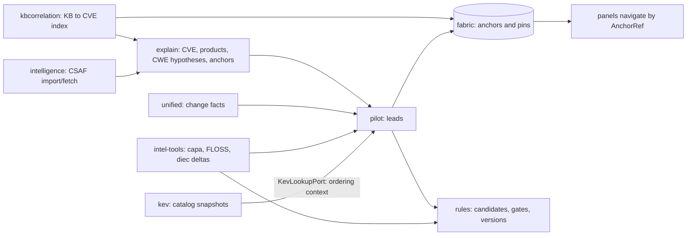

# 25. Intelligence: CSAF, KB, KEV, patch-intent leads, YARA-X rules, capa/FLOSS/diec, anchor fabric

The "Program E" feature packages that add context around a comparison. All are Qt-free, stdlib plus pydantic, strict and frozen contracts, additive persistence through reserved enrichment kinds, and talk to each other through ports. For each: what it does, what is built, what is planned. Plans: `docs/specs/program-e/*-integration-plan.md`. Previous: [24](24-acquisition-and-enrichment.md). Next: [26](26-packaging-and-bundle.md).

## Summary

| Package | Contract | CLI verb | Panel | State |
|---|---|---|---|---|
| `intelligence/` (CSAF, CWE hypotheses, anchors, explain) | `intelligence/1` | `intelligence` | none | built (core, reports, CLI) |
| `intelligence/tools/` (capa, FLOSS, diec) | `tool-evidence/1` | `intel-tools` | Capabilities **planned** | adapters, runner, store, delta, CLI built |
| `kbcorrelation/` | `kbcorrelation/1` | none registered | KB **planned** | K0 contracts and K1 sources, index, import/plan dispatcher built; fetch, search, panel not on `main` |
| `kev/` | `kev/1` | `kev` | KEV dock **planned** | core, store, transport, CLI, KB adapter, project row, report block, view model built |
| `pilot/` (patch-intent localization) | `pilot/1` | `pilot` | Leads (built) | core, adapters, rule table, store, report, CLI, Leads dock built |
| `rules/` (YARA-X) | `yara-rules/1` | `rules` | Rules **planned** | contracts, synthesis, windows, engine worker, store, CLI built; live evidence seam not wired |
| `fabric/` (anchor fabric) | `fabric/1` | `fabric` | none | pure core, store, pins, converters, CLI built |

## CSAF advisories and CWE hypotheses (`intelligence/`, SPEC-28 CSAF engine)

- **Validation** (`csaf/validate.py`, about 1,000 lines): three layers in order, never executing or rendering advisory content: strict JSON parse, schema validation against the vendored OASIS CSAF 2.0 schemas (`schema_data.py` is generated by `tools/generate_intelligence_schemas.py`), then the mandatory tests of the CSAF standard. `import` caps files at 16 MiB.
- **Transport** (`csaf/transport.py`): host `msrc.microsoft.com` only; discovery reads provider metadata and the directory index and never guesses a file name; consent object names exact hosts; `.sha256` checked when present; offline mode replays an opt-in content-addressed cache with no socket.
- **Storage** (`storage.py`): append-only source snapshots; exact bytes and normalized facts in content-addressed sidecar files under the project (`intelligence/`), pointer rows of kinds `advisory-source` and `advisory-facts`; local paths are never stored.
- **Applicability** (`csaf/applicability.py`, `csaf/identity.py`): ties advisory products to the two artifacts only through *verified identity facts* (SHA-256 read on the verified handle, `VS_FIXEDFILEINFO` versions, PE facts). A file name never maps to a product; analyst assertions (`--older-product`, `--newer-product`) are labelled as such.
- **Explain** (`explain.py`, `reports.py`): joins advisory facts, CWE profile (`lexicon.py`, versioned), rule hypotheses (`hypotheses.py`: expected patch operations per weakness family) and search anchors (`anchors.py`: module, API, string, feature, component, PDB hints, each naming its source pointer), with explicit unknowns; exports canonical JSON or escaped LF Markdown. It restates vendor claims; it never says a function contains or fixes the CVE.

## capa, FLOSS and Detect It Easy (`intelligence/tools/`, SPEC-29 tools)

Adapters verified against capa 9.4.0, FLOSS 3.1.1 and diec 3.21 (`tools/intel_tools_pin.json`, contract `intel-tools-pin/1`, `verified: false`: digests are trust-on-first-use measured from one download each, to be re-hashed from a second path before beta).

- `process.py` runs one tool on one artifact: a private scratch directory holds a verified read-only copy under a fixed name; spawning only via `jobs.run_process`; per-job memory cap (FLOSS emulation default 4,096 MiB). Tools are *inputs*, never the target; the target is never executed.
- `runner.py` profiles: `basic` = capa; `context` = capa + FLOSS; `full` = capa + FLOSS + diec. Jobs = engines x {older, newer}; at most 2 in parallel.
- `common.py` strict `tool-evidence/1` records; `normalize.py` canonical module-relative addressing and verified offsets; `store.py` rows `tool-run` and `tool-evidence` (never derived, so retention never deletes them); `delta.py` older/newer deltas that never average, score or rank. FLOSS deobfuscation (a CPU emulator) needs `--floss-deobfuscate` and prints a consent text. A build that is not the pinned release needs `--<tool>-accept-untested` and is recorded as untested. diec is a quality gate only.
- `capa_panel` (Capabilities dock, Ctrl+Shift+A) is a manifest slot only.

## KB correlation (`kbcorrelation/`, KB-integration-plan)

Goal: KB number to CVE to product scope, with explicit coverage, offline first. Built: strict contracts (K0), KB/CVE syntax (`ids.py`: `KB` + 4 to 10 digits), product alias catalog and scopes, in-memory reverse index with coverage arithmetic, CVRF monthly parser and CSAF bridge (K1), local importer, request-plan preview (`sources/net_plan.py`, K1) and the `kb index import|status|verify|plan` dispatcher in `cli_index.py`. Not built on `main`: the `kb` verb assembler, the consented monthly index sync (K6), KB search over the network and the KB wizard/panel (K4b/K7 exist only on an unmerged worktree branch per ledger D). `ports.py` keeps the package from importing `intelligence`, `acquisition`, `enrichment` or `unified`.

## CISA KEV (`kev/`, SPEC-46)

KEV is *context about one CVE* and **never alters a ranking** (nothing in the package imports ranking code). Strict `kev/1` records and an in-memory `KevCatalog` (`contracts.py`); `parse.py` reads untrusted catalog JSON strictly (no duplicate keys, NaN, size and entry caps; every CISA string cleaned to one plain line); `store.py` content-addressed snapshots (`snapshots/<raw sha256>.json.gz`, only `prune` deletes); `join.py` exact CVE join, freshness and snapshot delta with the clock as a parameter; `transport.py` consented HTTPS (hosts `raw.githubusercontent.com` or `www.cisa.gov`, slow-drip protected after audit RA-3); `service.py` shared by CLI and dock; `ports.py` `KevLookupPort`, the only door other features use; `project_context.py` the `kev-context` row recording what a catalog said on the day it was looked at, with drift; `kb_adapter.py` composition with the KB view (reading order, timeline phrase, explicit abstention); `view_model.py` and `teach.py` (guide hooks, deferred) and `tooltip_entries.py`. The live probe is `live-kev.yml` (advisory).

## Patch-intent localization (`pilot/`, SPEC-30, contract `pilot/1`)

Ranks every changed function pair as a *lead*: a place to look, ordered by explainable rules, not likelihood.

- **Inputs** (`collect.py`, `sources/`): Ghidriff rows resolved to RVAs with PE layouts, B1 signals, unified result, tool deltas (capa/FLOSS/DiE as observations), imports (`calls.py` import delta as second witness), advisory side (`advisory.py` adapts `IntelligenceReport` or a bare CVE record), KEV as ordering context only. Observation kinds are `prefix:slug` strings.
- **Core** (`service.localize`): per CVE context, evaluate each rule's expected changes three-valued (`rules/evaluate.py`; rule table `rules/data.py` is Python literals validated at import), fuse (`fusion.py`: observations of one candidate against one CVE's hypotheses; shared origin counts once via the fabric's origin table), derive the **mechanism tier** (`tiers.py`, first match wins: `moderate`, `tentative`, `unexplained`, `contested`, `not-assessed`; `strong` is *never assigned* because it needs a typed dominance or dataflow channel that does not exist) with caps (confounded window without locality, toolchain change or packed binary, unverified CVE gate), and order (`ranking.py`: tuples of small integers, ties explicit, no weights, no floats). Classes `fit`, `review`, `partial`, `code`, `queue`; CVE gate `applies`, `asserted`, `unverified`, `conflict`, `not-applicable`, `none`.
- **Persistence** (`store.py`): `intelligence/pilot/<result_id[:16]>/{manifest.json, assessment.json.gz}` plus pointer rows of kind `patch-intent`; the `result_id` hashes every input digest so staleness is derived. Analyst events (pin, unpin, dismiss, restore, note) are separate append-only rows and never change a lead's class.
- **Surfaces**: `pilot` CLI, JSON/Markdown reports (`report.py`), `why.py` plain-text explanation, `read_model.py` and `ui_leads.py` (Leads dock). Offline, reads stored results only.
- Evaluation: `pilot-eval.yml` is advisory; the oracle (`PIL-T`) and synergy ledger live under tests.

## YARA-X rule workflow (`rules/`, SPEC-47, contract `yara-rules/1`)

For one accepted changed-function pair, propose candidate rules, vet them against a series, and export a `.yar` file.

- **Closed-grammar synthesis** (`synth.py`, grammar `yrx-gen/1`): the one serializer; user or tool text can never inject rule syntax. `features.py`/`candidates.py` turn strings, imports, capabilities and byte windows into ranked candidates (at most 3 per direction and 200 per run); `window.py` and `masks.py` build address-independent hex windows (positive evidence only; iced-x86 marks layout-dependent bytes via `adapters/mask_iced.py`).
- **Eight gates** (`gates.py`, pure and total): `elig` (change reviewed as material), `len` (at least 16 literal bytes), `wild` (wildcard share at most 40 percent), `uniq` (hits in its own build), `sep` (no hits in the other build), `compile` (compiles with YARA-X), `secret` (no secret-looking strings) and `dist` (both builds share one toolchain, from the DiE quality flags). The blocking gates are `len`, `wild`, `uniq`, `sep`, `compile`, `secret`. Missing input is `unknown`, never `pass`.
- **Engine** (`engine.py`, `worker.py`, `runner.py`): YARA-X runs only in a hidden memory- and time-capped child through `jobs.run_process`; the parent, GUI and CLI never load the extension (a scan holds the GIL). Extra `rules` (`yara-x>=1.0,<2`; CI pins 1.21.0).
- **Store** (`store.py`): append-only rows `rule-candidate`, `rule-decision`, `rule-version`, `rule-test`, `rule-export`. Accepting stores a version and writes no file; `export.py` writes a new `.yar` and never replaces one; refuses a path inside a Git working tree unless allowed.
- **Test matrix** (`matrix.py`): versions as columns, builds as rows, each cell scored against what you expected.
- **Seam**: `ports.py` Protocols; the CLI's `BACKEND` (`PairBackend`) that reads live pair evidence is set by wiring code that is not on `main`, so `rules propose` reports it and changes nothing.

## Anchor fabric (`fabric/`, SPEC-48)

A shared, read-mostly store of typed **anchors** that every panel and feature can point at. Anchor kinds: function, string, import, capability, rule, build_fact, advisory_phrase, cve, kb, cwe (roles `observed`, `stated`, `hint` constrained per kind). Producers: `core, ue, cap, die, wb3, wbq, wb2, wb1, yrx, kb, kev, pil, analyst`. Ids are `domain_id`s over canonical JSON (`ids.py`); witnesses carry origin tags so evidence from the same upstream data counts once (`origins.py`: for example `D_vendor_text` for every repetition of an advisory's claim). `store.py` keeps `anchor-batch` rows (one per producer and batch); `pins.py` keeps `anchor-pin` events (analyst pins that no producer retraction can reach); `convert.py` adapts KB and PIL records. The `fabric` CLI is read-only. A stale or unreadable batch yields a *partial* read: a missing anchor is unknown, not a negative answer. `patchtrace panels list` currently warns that `leads` emits anchor kinds no built panel handles (advisory phrase, build fact, capability, import, rule, string): navigation to them waits for the planned panels.

## How the packages connect

Arrows are data or port dependencies, not imports: each box reaches the next through a `Protocol` in `ports.py` or through stored rows, so a package can be built, tested and replaced alone.

## Cross-cutting rules every package here follows

1. **Strict contracts, additive persistence.** Pydantic strict, frozen, `extra='forbid'`; a new field is appended with a default; error codes are fixed templates (`PT-KEV-*`, `PT-PILOT-*`, `PT-RULE-*`, `PT-FAB-*`, `PT-KBC-*`, `PT-INTEL-*`, `PT-TOOL-*`), never raw advisory, file or engine text.
2. **Untrusted text.** Advisory text, KEV strings, tool output, rule text and function names are bounded and cleaned at the boundary (`hostile_text`, `clean_line`) and rendered as plain text; Markdown reports escape `~`, `:` and markup and use LF line endings.
3. **Network only in consented transports**, each with an opener parameter, an exact host allow-list, a cap on size, time and slow-drip behaviour, and cancellation. `kev`, `intelligence/csaf` and `acquisition` share one pattern; `kev` avoids the slow-drip flaw found in audit RA-3; the audit routed the same fix to the CSAF and enrichment transports (slice B13), and acquisition has a total per-download deadline.
4. **Never average, never vote.** Origins make shared evidence count once; unknown stays unknown; conflicts are kept (`contested`).
5. **No claim beyond the evidence.** A claims profile bans probability and vulnerability wording in pairing panels. Leads, advisory facts and KEV entries are context for a human, not verdicts.
6. **Analyst events are append-only** and never edit a result (`pilot-review`, `anchor-pin`, `rule-decision`).
7. **Staleness is derived from input digests** (`result_id`, `Guard`), so an old result is shown as stale rather than silently reused or deleted.

## What is verified and what is not

Built and tested with synthetic or recorded fixtures, hermetically (no network, no Microsoft binaries): every package above; tests are named by slice (for example `tests/test_pilot_*.py`, `tests/test_kev_*.py`, `tests/test_rules_*.py`, `tests/test_fabric_*.py`, `tests/test_intel_tools_*.py`). **Not verified live or on Windows:** capa/FLOSS/diec runs on real Windows binaries and their pin digests (`verified: false`), YARA-X on the frozen Windows build (the `rules` extra and Rust crate notices need the build to ship them; B-0 follow-ups in ledger B), the live KEV and NVD/MSRC probes beyond their advisory CI jobs, and any hands-on analyst acceptance of the Leads dock. Evaluation of patch-intent localization against the oracle runs in the advisory workflow `pilot-eval.yml`; no gate result is recorded in this guide.
