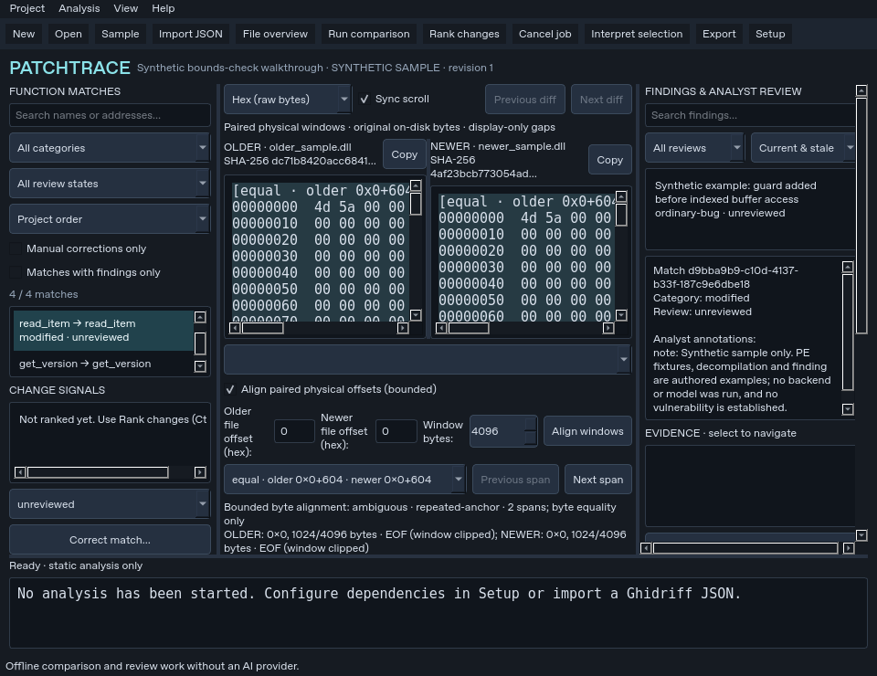

# Paired raw-offset desktop workflow — 2026-11-18

## Scope and source identity

This change restores the bounded paired-window desktop route for RD-F03. In
Hex or Binary mode, an explicit checkbox enables independent older/newer
physical offsets and a 16..4096-byte window. The existing pure row model and
alignment implementation supply physical gutters, exact byte spans, ambiguity
and EOF explanations. Copy uses the original verified windows with provenance;
display-only gaps are excluded.

| Identity | Exact source |
| --- | --- |
| Integration baseline | `ed4557257cde90a2c10bd81d1d0d469886c84687` |
| Selectively recovered historical source (#168) | `b304034e3c310528f7e0a3206eda48c94e0a6873` |
| Specification and test-first precursor | `640baa22` |
| Implementation candidate | `e4506666edefbbc22419ff97874e3edc599f94e7` |

The historical adapter and relevant tests were compared with the current
inspection, raw-view and task infrastructure before recovery. Existing
inspection-thread reaping repairs were already present and were not duplicated.
The historical branch's native research experiments were not recovered.
`raw_alignment_view.py` and `representations/alignment.py` remain byte-for-byte
unchanged from the integration baseline.

The adapter owns its controls, registered tooltips, generation/context guard,
span navigation and exact-window copy. Workers receive a frozen `WindowRequest`
containing verified readers and scalar values. Qt objects, the project service
and SQLite remain on the GUI thread. Changing inputs, match, project, revision,
orientation or representation; replacing inspection; hiding the pane; and
closing the window cancel the current generation and clear copy eligibility.
Late results and errors must still match the complete context.

The fixed raw navigation construction moved unchanged into the adapter, leaving
`ui.py` at **3,071 lines**, below the unchanged **3,077-line** ceiling. Default
fixed-offset and Base64 behavior, pure backend bounds, project schemas and
persistence remain unchanged. Public physical-offset navigation exits paired
mode before selecting the ordinary raw page.

## Actual verification and preserved failures

All GUI runs used the existing virtual environment's Python and
`QT_QPA_PLATFORM=offscreen`. Results establish local behavior on synthetic
project-owned fixtures, including actual worker threads and Qt event delivery.

| Run | Actual result | Meaning |
| --- | --- | --- |
| Test-first baseline | **1 failed in 1.85 s** | `MainWindow.raw_alignment` was absent; the original failure is preserved. |
| Initial implementation selection | **1 failed, 119 passed in 20.62 s** | The isolated quit subprocess imported the shared environment's older editable checkout, which lacked the new module. |
| Final affected selection | **182 passed in 32.74 s** | Paired UI, pure rows/alignment, existing UI and inspection, global tooltip sweep, and unchanged host-seam checks. |
| Current-source headless CLI guard | **1 passed in 0.71 s** | Actual CLI subprocess imports neither `PySide6` nor `patchtrace.ui` modules. |
| Whole repository Ruff | **Passed** | `ruff check src tests tools`. |
| Whitespace check | **Passed** | `git diff --check`. |

The intermediate failure was repaired only in the new test harness: the
subprocess now explicitly imports this checkout's `src` through `PYTHONPATH`.
The environment's active Python entry point is retained. No assertion or
production behavior was weakened. The final affected selection includes the
actual application-quit subprocess control. Earlier test selections overlap
with the final selection and must not be added to it.

The affected selection covers exact copy through buttons, Ctrl+C and context
menus; independent offsets; repeated requests and span selection; Hex/Binary and
Base64 transitions; invalid size/offset refusal; inspection failure; all named
context invalidations; deliberate late worker completion after cancellation;
actual application quit; and QObject ownership after close. The current global
tooltip test constructs the registered controls without adding exemptions.
Layout checks cover 1,440/1,100 widths, resizing to 960, and 12/14/18/24/28-pixel
status fonts. Pure backend tests retain their exact-byte, EOF, ambiguity,
cancellation and maximum-window assertions.

An actual 960×740 offscreen synthetic-sample capture was also inspected. Paired
inputs, span controls and the complete wrapped ambiguity/EOF summary are visible
at that width. This is a rendered-fixture observation, not native manual or
assistive-technology acceptance.



## Commands

The interpreter for this receipt was
`/workspace/scratch/3a6632a6e5ff/venv/bin/python`, run from the isolated
`raw-alignment` worktree. The final source selection was unchanged when committed
as `e4506666`.

```sh
QT_QPA_PLATFORM=offscreen python -m pytest -q \
  tests/test_ui_raw_alignment.py \
  tests/test_raw_alignment_view.py \
  tests/test_representation_alignment.py \
  tests/test_tooltips.py \
  tests/test_gui_host_seam.py \
  tests/test_ui.py \
  tests/test_preflight_overview.py \
  tests/test_ui_inspection_signing.py \
  tests/test_audit116_stale_inspection_failure.py \
  --tb=short --junitxml=affected-green.xml

PYTHONPATH=/workspace/scratch/c7a9e8d98848/raw-alignment/src \
  QT_QPA_PLATFORM=offscreen python -m pytest -q \
  tests/test_cli.py::test_headless_entry_never_imports_qt \
  --tb=short --junitxml=cli-headless.xml

python -m ruff check src tests tools
git diff --check
```

The preserved `red.xml` identifies the first baseline test exactly. The initial
120-test selection comprised the first five files in the final command above.
The remaining four files were added to cover existing raw-view and inspection
integration after the subprocess harness correction.

## Evidence and open gates

[Manifest](raw-alignment-workflow-20261118/manifest.json) identifies the source
hashes, raw-file hashes, screenshot and limits. [Raw receipt archive](raw-alignment-workflow-20261118/raw-evidence.zip)
preserves all nine original log/JUnit files, including both unsuccessful runs.
The archive is 9,232 bytes with SHA-256
`423e4ee02f1fbe2c22764b2bd7763e3a5134c93ba3de929e08e13627e7b41fcd`.

Independent review, combined actual-head full-suite and hosted qualification,
native Windows packaging, native manual visual/keyboard/accessibility acceptance
and broader performance acceptance remain open. No target binary, analysis
engine or network workflow was executed for this feature. No accuracy,
release-readiness or whole-project completion claim follows from these results.
