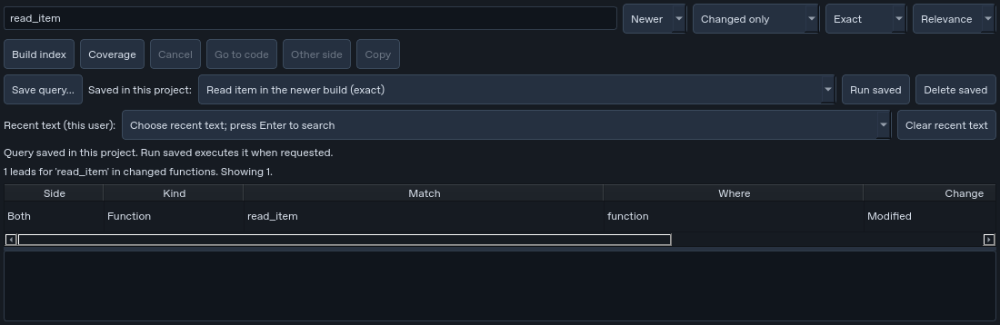

# Saved queries and per-user recent text — 2026-11-18

## Scope and exact source

| Identity | Commit |
| --- | --- |
| Integration baseline | `c8a6840c5e89e7f7825c775d0cde8b1dfb77f54a` |
| Specification and test-first precursor | `ada1a164` |
| Implementation candidate | `e705974b0c8a13be0942a172b93bb1cdfa74895f` |

The desktop and CLI now use the existing saved-search stores. Save records the
effective query, Saved selection lists project-owned rows, Run saved reparses
and searches again, and Delete saved appends the existing tombstone. Merely
listing, saving, selecting or deleting a saved query performs no index build or
search. The GUI uses its existing owner-thread service; the CLI uses its one
existing opener and `finally` close path.

The current grammar reparses text with the saved validated mode. A compatible
`SavedQuery.mode` read field defaults to `auto`; no persisted schema changed.
The shared input helper represents effective side/scope controls in canonical
query text, keeps quoted phrases intact, and applies existing length/grammar
limits after canonicalization. Stored term lists and other query clauses are
never trusted for execution. Unknown modes produce an unreadable row rather
than an executable query.

The saved name dialog and row actions are bound to project identity, revision,
service identity and controller epoch. A project change dismisses the dialog,
clears the previous selection and rebinds the store. Run rechecks that its saved
row still exists. Delete remains idempotent.

Recent history is explicitly **per-user query text**, separate from project-owned
saved queries. Recall fills the editor in automatic mode, restores textual
filters, clears old results and waits for Enter. Clear recent text affects only
settings. The adapter uses the unchanged settings string-list API: at most 20
queries, 256 characters each, and 8,192 bytes of serialized UTF-8 JSON. It drops
whole oldest entries to satisfy the serialized budget. Settings failures do not
stop a query; a failed clear is reported as a failure.

`ui.py`, `PanelSettings`, the persisted search contracts and enrichment storage
are byte-for-byte unchanged from the baseline. The existing `search.save` and
`search.saved` tooltip exemptions were removed because actual controls now
exercise both entries. The real name dialog is constructed with the panel and
participates in the existing control audit.

## Actual results and retained failures

| Run | Result | Interpretation |
| --- | --- | --- |
| Authored controls before implementation | **14 failed, 8 passed in 1.52 s** | Missing GUI/CLI workflow, mode round-trip refusal and missing settings adapter were reproduced. Some argument-rejection controls already passed because the old CLI did not recognize the new flags. |
| First affected implementation selection | **189 passed in 12.08 s** | Existing saved-store/search CLI/search UI/tooltip tests plus the initial new controls. |
| Additional self-review controls before correction | **2 failed in 0.61 s** | Ordinary words `side`/`scope` were incorrectly removed by canonicalization; failed settings writes falsely reported that recent text had been cleared. |
| Final expanded affected selection | **374 passed in 16.65 s** | Both defects corrected; expanded real GUI/CLI, compatibility, corruption, query, tooltip and unchanged host-seam coverage. |
| Whole repository Ruff | **Passed** | `ruff check src tests tools`. |
| Whitespace check | **Passed** | `git diff --check`. |

All original logs/JUnit are preserved. The selections overlap and must not be
added. The final selected source and tests were unchanged when committed as
`e705974b`.

### Meaningful execution controls

The GUI journey constructs a real `MainWindow` and project service, saves an
exact/newer/changed query before any index work, explicitly builds through the
default `SearchService`, runs the saved query, checks the returned evidence and
reopens the project. An injected refusal of any extra `ProjectService.open`
protects the GUI ownership boundary. The project remains usable after close and
reopen.

A separate actual CLI subprocess saves, executes and deletes the same kind of
query, then refuses the deleted run target. Its `PYTHONPATH` explicitly names
this checkout, avoiding the shared virtual environment's older editable source.
It asserts no `PySide6`, `patchtrace.ui` or `patchtrace.search.qt_*` import. The
storage-only CLI controls replace `SearchService.__init__` with a failure so
list/save/delete cannot silently instantiate or execute the search layer. Other
controls verify exactly one open and close, including a typed storage failure.

Compatibility tests publish original-format rows without explicit mode,
contract-valid rows with deliberately tampered stored clauses, and a corrupt
mode. Reopen/list retains the legacy row, counts the corrupt row, and reparses
the tampered row from its text and validated mode. Modal project replacement,
old-epoch deletion, and a saved row deleted before Run all refuse stale work.
Unicode histories exercise the actual serialized budget while retaining full
256-character individual queries; settings write failures and clear behavior
are observed directly.

The current-source real GUI capture below was visually inspected. Both ownership
labels, all saved/recent controls and result rows remain visible. This is
offscreen evidence on a synthetic fixture, not native manual/accessibility
acceptance or engine accuracy evidence.



## Reproduction

The interpreter used was
`/workspace/scratch/3a6632a6e5ff/venv/bin/python`, from the isolated
`saved-search` worktree. Qt runs used the offscreen platform.

```sh
QT_QPA_PLATFORM=offscreen python -m pytest -q \
  tests/test_search_saved_workflow.py \
  tests/test_ui_search_saved.py \
  tests/test_search_saved.py \
  tests/test_search_cli.py \
  tests/test_ui_search_panel.py \
  tests/test_tooltips.py \
  tests/test_gui_host_seam.py \
  tests/test_search_query.py \
  tests/test_search_pilot_buildenv_bugfixes_20261111.py \
  --tb=short --junitxml=affected-green.xml

python -m ruff check src tests tools
git diff --check
```

The initial baseline command used the first two test files; the first affected
command used the first six. The separate two-failure receipt identifies the
exact added controls. The current-source CLI journey is inside
`test_search_saved_workflow.py` and the default GUI journey is inside
`test_ui_search_saved.py`.

## Evidence and remaining gates

[Manifest](saved-search-workflow-20261118/manifest.json) records source hashes,
the four unchanged boundary modules, image identity and every raw-file hash.
[Raw archive](saved-search-workflow-20261118/raw-evidence.zip) preserves nine
original files, including both unsuccessful runs. It is 15,203 bytes with SHA-256
`c4e9db1065d280cd345c35dff1bcbfe6e169026fdc2aa13471d0d497ef9e718b`.

Independent root review is pending. Combined actual-head full-suite/hosted
qualification, native Windows packaging, native keyboard/accessibility/manual
acceptance and broader performance gates remain separate. No target binary,
analysis engine, network acquisition or model provider ran for this work. The
older tool/advisory source-snapshot wiring gap remains a distinct scope; this
change does not claim completion of every planned search capability.

## Subsequent independent-review repair

Root later found a delayed Build completion executing recalled recent text without
Enter. The original results above remain historical. Source `c30c7911` binds
automatic submission to the captured query generation; the [repair receipt](saved-search-build-race-20261118.md)
retains the independent failure and 376-test affected qualification.
