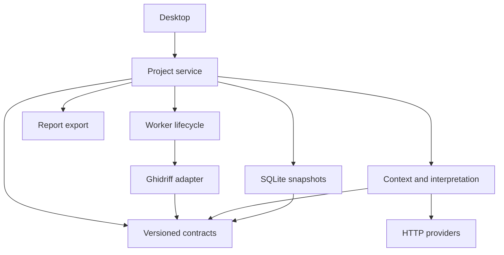

# PatchTrace beta architecture (SPEC-01, schema v1)

## Objective and decisions
PatchTrace is a local Windows 11 x64 desktop for static PE AMD64 patch comparison, manual review and optional evidence-linked hypotheses. Older/newer is selected explicitly. No target binary is executed. Python 3.12 + PySide6 separates desktop from a pure Python domain layer and Ghidriff CLI process. Ghidra/Java/Ghidriff are external analysis dependencies; the desktop ZIP bundles Python and Qt. AI is optional. SQLite stores validated JSON snapshots and append-only revisions in transactions; immutable copied inputs and raw analysis outputs accompany the database. Qt widgets provide keyboard accessibility and scalable plain-text code views. JSON schemas are generated from strict Pydantic models. Upstream schemas are accepted only through an adapter.

DEC-01: avoid embedding Java in GUI. DEC-02: use supported CLI, preserve raw outputs; never fork or patch Ghidriff; an in-house DERIVED engine (SPEC-31, `unified-engine/`) may match independently; Ghidriff stays primary and its results are never overwritten (amendment A-01, status 2026-11-04: APPLIED). DEC-03: implement a Diffalayze-inspired bounded interpretation flow, reuse conceptual staging with attribution rather than importing its acquisition/execution workflow. Exact reuse awaits source investigation. DEC-04: Ollama localhost and OpenAI-compatible HTTPS endpoints through standard library HTTP; credentials session-only, never persisted. DEC-05: preserve all beta requirements in traceability even if runtime verification is blocked. Never call an unverified path complete.

## Dependency graph

Build order: contracts → ingestion/persistence/normalization → backend/jobs and context/providers/reports → service → desktop → packaging/acceptance.

## Interfaces and ownership
Domain models are immutable by convention except project aggregate changes in the service. UUID identifiers are assigned by PatchTrace. Every model forbids extra fields. Database loads validate schema versions and relationships before use. Workers return values to UI thread through queued signals; only service transactions change project state. One active job per window, one writer per project through exclusive lock file. No module imports UI except UI. Cancellation is cooperative for providers and process-tree termination for analysis; delivered remote data cannot be recalled. Logs omit credentials and are capped.

Project directory: `project.sqlite3`, `.patchtrace.lock`, `artifacts/{sha256}.bin`, `runs/{run_id}/raw/`, `exports/`. Relative artifact paths cannot escape root. Each DB commit stores current validated aggregate plus history. Backup uses SQLite backup API and copied artifact/run files. Interrupted runs are marked failed on load. Future schema versions fail closed; v1 needs no legacy migration. Migrations require backup and explicit ordered transforms, never reinterpret future data.

**Unified engine (SPEC-31 A-01b, status 2026-11-04: APPLIED as this note).** The one-job rule covers a unified run (extraction plus worker) as far as the code enforces it: `ui_unified.UnifiedController.run_availability` refuses to start a unified run while a Ghidriff analysis or an engine run is active or while another unified run is running. The converse is NOT enforced yet: `MainWindow.update_controls` enables Run comparison from `self.worker` alone, so a Ghidriff run can start while a unified run is active (open gap; owner of `ui.py`). The project directory gains `runs/<run_id>/unified/`: `ir/<ir_key[:16]>/` (IR sidecar, `unified/ir/place.py`), `results/<result_id[:16]>/` (result sidecars, `unified/store.py`) and, only with `BackendConfig.retain_gzf`, `gzf/{older,newer}.gzf` (`unified/extract/retain.py`, see below; no code removes them after a unified run).

## Ingestion and worker contracts
`inspect_artifact(path, side, root) -> Artifact`: regular readable PE file, 1 GiB maximum, DOS header, bounded PE offset, machine 0x8664, PE32+ magic. Hash during copy in chunks; source size/mtime before and after must agree, otherwise delete staging. Atomic rename after flush. Original untouched. Identical SHA-256 pairs are valid and may skip analysis with explicit identical status. Optional symbols are deferred from automated loading, can be recorded as analyst documents.

`normalize_ghidriff(raw, project, run_id) -> list[FunctionMatch]`: handle modified/added/deleted functions from pinned known output; require recognizable function structure; reject unknown schema rather than silently empty. Missing code/address/assembly is represented explicitly. Raw source hashes and backend metadata accompany run. Upstream percentages are uncalibrated match metrics, never vulnerability probability. Manual split/merge/ambiguous relations use multiple function IDs. Equality of addresses never establishes a match.

**Repeated upstream functions (SPEC-31 A-28, status 2026-11-04: APPLIED, slice `ghidriff-1toN`).** Each upstream record has the identity (side, `fullname` or `name`, parsed address): the address is read with `enrichment.identity.parse_address`, as every consumer reads it, so `0x180001000` and `180001000` are one address and an empty or unparsable address is address-less (follow-up 2026-11-04). The normalizer validates and indexes the whole document before it emits a row. It rejects the document with `PT-SCHEMA` when (a) the same (old identity, new identity) pair appears in two `modified` entries (CORE-2, a copied entry: `upstream pair is repeated`); (b) one identity appears with different record content, compared as canonical JSON (`upstream function is repeated with conflicting content`; an address-less record cannot be told apart from another one of the same name, so it rejects too); (c) an identity repeats inside `added`/`deleted`, or is both one-sided and paired (`upstream function is repeated`: "no counterpart" and "matched" at once); (d) (new with A-28, for every document, not only those with repeats) an upstream record carries a PatchTrace-owned metadata key: `upstream_similarity`, `diff_types`, `upstream_name`, `instructions_hash`, `assembly_unavailable` or `upstream_one_to_many` (`carries the PatchTrace-reserved metadata key`). Rule (d) rejects rather than strips: these keys state what PatchTrace derived from the entry (calibration, the unified engine and the tier-R scorer read `upstream_similarity`), so a planted value is either hostile or from another producer; silently dropping it would make the normalized record disagree with the preserved raw file without telling the analyst, and rejecting keeps the "reject unknown schema" rule. The one accepted repeat is an identity with identical content on one side of two or more distinct `modified` pairs: pinned Ghidriff 4f5d895 memoises `enhance_sym` per (symbol, program), so its real one-to-many matches repeat one record (a pin bump must re-run a live one-to-many fixture; a Ghidriff that enhanced each pair separately would turn real one-to-many back into rule (b)). The connected components of the `modified` pair graph that contain such a repeat (1:N, N:1, or an N:M chain such as A1-B1-A2-B2) are conflict groups, and no pairing inside a group becomes a match: not the first seen (Ghidriff's order is correlator and bucket order, not a ranking) and not the highest ratio (PatchTrace would take a side). Each distinct function of a group becomes exactly one `FunctionRecord` in its own one-sided, non-manual `ambiguous` match (`review` `needs-review`, `quality` `unknown`, no `match_types`, a reason naming the group and "Correct match"); these rows follow the `modified` rows, groups in order of their first entry, older records before newer, each by (name, address). Such a record carries no `upstream_similarity` and no `diff_types` (both belong to a pair) and instead the side-relative key `upstream_one_to_many` = `{group, pairings: [{entry, pointer, counterpart: {name, fullname, address}, match_types, diff_types, ratio}]}`, sorted by `entry` (the index into `functions.modified` of the preserved raw file, `run.raw_sha256`); `pointer` is the RFC 6901 pointer `/functions/modified/<entry>`; `group` is `g1n-` plus the first 16 hex digits of the SHA-256 of the canonical JSON of the group's sorted identities, so it does not depend on input order. Conflicting claims are kept per pairing, never averaged. Each claim is referenced from both of its endpoints, so any aggregator deduplicates claims on (run id, entry). A document without repeats and without reserved keys normalizes exactly as before (golden test); before A-28 a planted reserved key in such a document was silently kept, now it is rejected by rule (d). One document that spells one address two ways is rejected by rule (b). The analyst resolves a group with the existing manual correction, which already accepts functions from several rows of one run. The unified engine builds the group from `matches.address_matches` (SPEC-31 06 s10 item 3); the tier-R and attention evaluators do not score such a pair (`tier-r-engine-output/1` has no field for an abstention next to `implicit_unchanged`) and report it `failed` with a `one-to-many` reason.

`diff_hunks(older, newer, match_id)` aligns original text using half-open line ranges. Up to 2000 lines per side, use exact SequenceMatcher alignment with popularity filtering disabled. From 2001 through 10000 lines, enable popularity filtering to bound repeated-line matching work; alignment is a display aid, never binary correspondence evidence. Above 10000 lines on either side, use a linear common-prefix/common-suffix scan and represent the remaining middle as one replace/insert/delete region. Equality regions must always contain identical original lines. `alignment_strategy` exposes the selected strategy so the desktop can disclose coarse large-region alignment; no assembly or missing code is invented.

`run_comparison(config, project, cancel_event, on_event) -> AnalysisResult`: shell=False, absolute executable path and argv; Python `-m ghidriff` only for configured external interpreter. Timeout 3600 seconds default. Output bounded to 100 MiB JSON and 2 MiB log tail. New unique run directory, no cache use until keyed by hashes/version/settings. On failure raw output quarantined, prior results preserved. Working and normalization-failure directories use `runs/quarantine-<canonical-UUID>` without dot-prefixed elements; older existing `.quarantine-*` directories are left untouched for backward compatibility. Before invoking Ghidriff, validate every component in the resolved `--output-path` (including project ancestors) because Ghidra refuses components whose names start with `.`. Reject an unsafe path with a specific PT-BACKEND error, rather than silently renaming or moving the analyst's project. On Windows, reject output paths 240 characters or longer with guidance to relocate the project under a shorter path; nested Ghidra project paths may impose stricter practical limits. Spaces and OneDrive directories without a dot-prefixed component remain permitted; pass paths as individual argv elements and do not rely on shell quoting. Use Ghidriff's separately supported `--project-location` and `--gzfs-path` options for a fresh private temporary workspace outside the case directory; Python's TemporaryDirectory lifecycle must remove this scratch after the contained process exits, both on success and error. Only raw comparison output (JSON/Markdown), analysis.log, and failure metadata belong under the case. Never delete previously completed case outputs. Default Ghidriff symbols remain under raw/symbols until a separately reviewed versioned cache is designed. `BackendConfig.allow_symbol_downloads` is a backwards-compatible opt-in bool (default false). When false, pass pinned Ghidriff's supported `--no-symbols` CLI flag; when true, leave upstream symbol behavior available. UI labels must communicate that this flag disables Ghidriff symbol processing, potentially affecting function naming and match quality. Record the choice in per-run provenance as `allow_symbol_downloads` plus `symbol_policy` (`disabled` or `online`) and `ghidra_settings` (`isolated-per-run`). Every Ghidriff child runs with `XDG_CONFIG_HOME` pointing at a fresh directory inside the private scratch workspace. Ghidra resolves its user settings directory from the `application.settingsdir` property, then `XDG_CONFIG_HOME` on every platform, then %APPDATA%/~/.config (ApplicationUtilities.getDefaultUserSettingsDir). Isolation prevents a symbol-server configuration persisted by an earlier manual or symbol-enabled Ghidriff run (PdbPlugin preferences) from being consulted: Ghidriff `setup_project()` (PyPI 1.0.0 and pinned commit 4f5d895) calls `get_pdb(allow_remote=False)` under `--no-symbols` and raises `FileExistsError` ("Symbols are disabled, but the symbol is already downloaded") whenever that persisted local store already holds a matching PDB. Isolation also stops symbol-enabled runs from writing symbol-server configuration into the analyst's global Ghidra preferences. The analyst's PDB caches and global settings are never read, modified or deleted. Ghidriff's `--jvm-args` is not used because PyPI ghidriff 1.0.0 declares it `nargs='?'` and iterates the string character by character (later upstream commits use `append`); the environment variable works with both. SPEC-53 now offers a PatchTrace-owned launcher for local PDB mode: it forces an empty Ghidra symbol-server list, stages only identity-matched PDBs per run, and keys the raw cache by staged-PDB digest. This is configuration evidence, not an OS-level air-gap guarantee; GHR-5 remains unverified. If the FileExistsError still occurs (for example a PDB beside the analysed copy), diagnostics classify it as a cached-symbol conflict without echoing the path. This is not a guarantee of whole-system network isolation because Ghidra extensions and other processes are outside this flag's control. Offline mode performs no intentional dependency downloads by PatchTrace; air-gapped users still require local compatible tools. Reject nonboolean flag values to avoid unintended network behavior. A crash may leave an abandoned OS temp directory to be handled by system cleanup. Scratch removal after a run is retried a bounded number of times; if it still fails (for example antivirus or a lingering Java child holding a file), the run keeps its real status and a warning names the leftover path — cleanup failure never turns a completed analysis into a failed one. User binaries and prior run files are preserved if preflight rejects a path. On Windows create subprocess suspended, attach to kill-on-close Job Object, then resume; fail if containment unavailable. POSIX process group kill. Never claim process isolation is a sandbox. Default memory/thread settings are forwarded only if verified supported. No invented hard memory cap.

**Launch argument rules (process-supervision audit items 2, 3 and 5, status 2026-11-04: APPLIED in `jobs.run_process`; the Windows-only behaviour is evidenced only by the `qa-windows` cases of `tests/test_jobs_windows_launch.py`).** `run_process` refuses an argv before anything is spawned, with a `ValueError('PT-BACKEND: ...')` that never echoes the refused text, when (a) any element contains NUL, on every OS (Windows would otherwise truncate the command line silently); or (b) on Windows argv[0] is a batch file (its name, case-folded and without trailing dots and spaces, ends in `.bat` or `.cmd`) and any element, argv[0] included, contains `&`, `|`, `<`, `>`, `^`, `%`, `!`, CR or LF. `CreateProcessW` runs a batch file through `cmd.exe`, which still parses these characters after `list2cmdline` quoting, so a hostile artifact file name passed to, for example, a pyenv-win `python.bat` shim could start a command; the message asks the analyst to configure the program `.exe`. Quotes, spaces, `=` and parentheses stay allowed (the dependency probe code contains quotes). The Windows environment block is sorted case-insensitively (upper-case order, as `CreateProcessW` documents) and refuses an empty name, NUL in a name or value and `=` in a name after its first character (the `=C:` drive entries stay legal). The Job Object limit flags are `KILL_ON_JOB_CLOSE` and `DIE_ON_UNHANDLED_EXCEPTION` (a crashed tool exits instead of waiting in an error-report dialog until the timeout; that every such dialog is suppressed is unverified), plus `PROCESS_MEMORY` only when a cap is given, and never a breakaway flag. The Job, process and pipe handles are released even when the final kill raises. Callers already turn a runner `ValueError` into a failed outcome.

`BackendConfig.retain_gzf: bool = False` (SPEC-31 A-01c, D-05; a non-bool is a configuration error). When true AND the Ghidriff process exited 0 without a stop reason AND the run was not cancelled, `run_comparison` calls `unified.extract.retain.retain_run_gzfs` BEFORE the private scratch is removed: exactly two regular, non-symlink `*.gzf` files whose names equal `<artifact file name>-<sha1[:6] of the artifact>.gzf` and whose total size is within L-36 (4 GiB) are moved into `quarantine/unified/gzf/{older,newer}.gzf` (renamed with the run directory by `publish()`) and `settings["gzf"]` records `{name, sha256, bytes}` per side. Any other layout, any I/O error or the flag off retains nothing; a warning event is emitted and the run is never failed or altered. argv, the raw-cache fingerprint and the settings of a run with the flag off are unchanged (regression test). A raw-cache hit runs no Ghidriff and therefore retains nothing.

## Context and interpretation contracts
`build_context(project, match_ids, max_chars=24000) -> AnalysisContext`: deterministic changed functions first then available caller/callee records, explicitly record unavailable references; assign evidence IDs to exact code side/function/line ranges. Bound total characters and record omitted/truncated data. Conservative token estimate ceil(UTF-8 bytes/3), a budgeting estimate rather than provider tokenizer equivalence. Context digest covers exact serialized payload, artifact hashes, run and matches. UI preview is exact request context. User starts each transmission explicitly. Remote HTTPS only; local mode loopback only, reject URL credentials/fragments and IPv4-mapped IPv6 literals (SPEC-41 R11). No tools or command execution. Timeout 120 seconds, which also ends a blocked connect or read; response cap 2 MiB (SPEC-41 R13, R14); no automatic retry of sent requests.

`interpret(context, provider) -> InterpretationRun`: instruct provider to distinguish observed changes, uncertainty, ordinary fixes, alternatives, support/counterevidence and proposed verification. Strict JSON response; one malformed response fails visibly and raw response remains quarantined in run. Every transport error becomes a `PT-PROVIDER` message with fixed text (SPEC-41 R33). Validate every cited evidence ID against exact context, including function/run/artifact ownership. Model confidence labels qualitative, review status starts unreviewed. No inferred CVE/severity/affected versions: a finding that names a CVE, CWE or CVSS claim absent from the context is dropped, the run keeps its other findings with a note, and a run whose findings are all dropped fails (SPEC-41 R29; severity and exploitability wording is not screened). Analyst conclusion is separately entered text.

## Findings and invalidation
Reanalysis, orientation swap, manual match change or settings change increments project revision and marks previous contexts, findings and annotations stale. Raw runs retained. Evidence navigation checks stale and run ID before jumping. Match override records original IDs, selected new IDs, timestamp and reason; can revert using history. Review accepted/rejected/needs-review states do not imply validation. Notes and bookmarks have analyst origin. Imports verify relationships, bounded size and schema; no pickle/eval. The shared strict JSON loader (`persistence.strict_json`) also bounds nesting at `MAX_JSON_DEPTH` = 128 arrays/objects and rejects lone surrogate escapes, both as PT-SCHEMA before anything is staged; secondary-engine parsers (rz-diff, BinDiff) apply the same loader and treat version strings beyond `int()` digit limits as unrecognised. `ingestion.safe_path` refuses NUL, components over 255 UTF-8 bytes, unencodable components and filesystem errors as PT-STORAGE, never a raw `OSError`. PE base-relocation blocks are checked against `MAX_RELOCS` before they are walked (2026-10-30, hostile-input sweep).

## Reports
`export_project(project, format, destination, include_code=False, include_notes=True) -> ExportManifest`: stable ID ordering, JSON v1, Markdown escaped text and HTML escaped values with no network assets/scripts. Default excludes code and raw provider text. Include hashes/run versions, current/stale status, unknowns and limitations. Redact absolute source paths by default. Write to sibling temporary then replace. Failure leaves prior report intact. An existing destination whose bytes differ is first kept beside it as `<stem>.previous-<sha256[:8]><suffix>` (created exclusively, never overwritten, skipped when identical; an existing backup must be a regular non-symlink file with exactly the expected bytes before reuse, otherwise export is refused; a failed backup aborts the export before the replace and removes its own incomplete file when possible); an existing file larger than the report cap is refused, not read or replaced (2026-10-28). Manifest records SHA-256, selected finding IDs, flags and schema version. Reports derive only from persisted project snapshots.

## Error taxonomy
PT-INPUT invalid/unreadable/changed/oversize/incompatible input; PT-SCHEMA unknown or malformed contract; PT-BACKEND missing/version/execution/timeout; use the pure `diagnostics.describe_backend_exit(code, sanitized_log_tail)` classifier for a *known* runtime failure (Ghidra dot-prefixed workspace, incompatible Java bytecode/JDK, missing Ghidriff module, Java heap exhaustion, full disk, permissions), and preserve original exit code and full bounded analysis log; unknown failures keep the generic error. Fixed category strings must not echo untrusted or secret-containing log text. PT-CANCEL cancellation; PT-PROVIDER transport/status/malformed/ungrounded; PT-STORAGE lock/corruption/disk-full; PT-EXPORT write failure. UI retains previous committed data, gives actionable message and recovery control. No silent empty success.

## Project-owned report destination protection (2026-11-01)

Project-backed report writes use `ProjectService.export_report` and pass `project_root` to `reports.export_project`. The optional root argument preserves the standalone renderer API used for previews; it does not infer project ownership. Before creating directories, staging or backups, project-backed export refuses any destination inside the project except its `exports/` subtree, and refuses registered artifact/raw evidence paths even if they occur there. Protect the database, WAL/SHM, lock, run/evidence/backup/sidecar stores through this rule. Resolve parent aliases for ownership checks; reject existing aliases to protected evidence. Preserve the existing final-symlink refusal and previous-report backup semantics. Ordinary external destinations and non-evidence files in `exports/` remain supported. GUI export must use the service-owned route; preview stays a throwaway standalone rendering. Refusal preserves project/evidence bytes, creates no report/backup/staging files, and leaves the project reopenable. This adds no wire-schema change and is not an OS-level filesystem sandbox.

`ProjectService.export_report` renders and checks ownership against a loaded committed snapshot, leaving an unsaved mutable in-memory aggregate untouched. Existing-destination alias checks are bounded to registered artifacts/raw evidence and fixed database/companion/lock paths; never recursively enumerate an entire project on the GUI export path. Namespace checks protect other project-owned internal stores without an unbounded file walk.

Committed report reads are non-mutating: `ProjectStore.load(*, recover_interrupted=True)` retains existing default startup recovery, while service export uses `recover_interrupted=False`. Export must neither mark queued/running records failed nor publish recovery/history changes, including when a destination is refused; normal reopen recovery remains unchanged.

Project adoption in MainWindow retains the original open service until the incoming project renders and recent-project state updates successfully. On failure, restore the original service/preferences/view, close the unsuccessful incoming service, and leave its directory available for retry. A KB creation completion must report retained-path/open failure rather than silently replacing the parent on failed rendering.

The generic adoption implementation is isolated in `gui.qt.project_adoption.adopt_project(window, service)`; MainWindow.set_service delegates without adding feature imports or exceeding its established line budget. The existing rollback/ownership contract remains unchanged.
