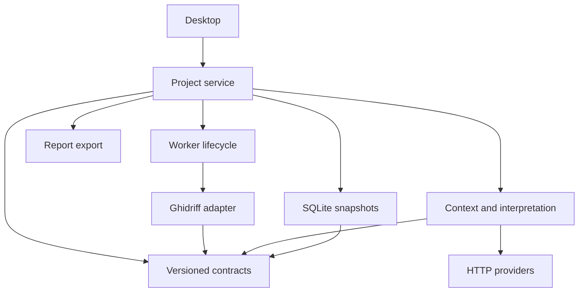

# PatchTrace beta architecture (SPEC-01, schema v1)

## Objective and decisions
PatchTrace is a local Windows 11 x64 desktop for static PE AMD64 patch comparison, manual review and optional evidence-linked hypotheses. Older/newer is selected explicitly. No target binary is executed. Python 3.12 + PySide6 separates desktop from a pure Python domain layer and Ghidriff CLI process. Ghidra/Java/Ghidriff are external analysis dependencies; the desktop ZIP bundles Python and Qt. AI is optional. SQLite stores validated JSON snapshots and append-only revisions in transactions; immutable copied inputs and raw analysis outputs accompany the database. Qt widgets provide keyboard accessibility and scalable plain-text code views. JSON schemas are generated from strict Pydantic models. Upstream schemas are accepted only through an adapter.

DEC-01: avoid embedding Java in GUI. DEC-02: use supported CLI, preserve raw outputs, do not fork matching. DEC-03: implement a Diffalayze-inspired bounded interpretation flow, reuse conceptual staging with attribution rather than importing its acquisition/execution workflow. Exact reuse awaits source investigation. DEC-04: Ollama localhost and OpenAI-compatible HTTPS endpoints through standard library HTTP; credentials session-only, never persisted. DEC-05: preserve all beta requirements in traceability even if runtime verification is blocked. Never call an unverified path complete.

## Dependency graph

Build order: contracts → ingestion/persistence/normalization → backend/jobs and context/providers/reports → service → desktop → packaging/acceptance.

## Interfaces and ownership
Domain models are immutable by convention except project aggregate changes in the service. UUID identifiers are assigned by PatchTrace. Every model forbids extra fields. Database loads validate schema versions and relationships before use. Workers return values to UI thread through queued signals; only service transactions change project state. One active job per window, one writer per project through exclusive lock file. No module imports UI except UI. Cancellation is cooperative for providers and process-tree termination for analysis; delivered remote data cannot be recalled. Logs omit credentials and are capped.

Project directory: `project.sqlite3`, `.patchtrace.lock`, `artifacts/{sha256}.bin`, `runs/{run_id}/raw/`, `exports/`. Relative artifact paths cannot escape root. Each DB commit stores current validated aggregate plus history. Backup uses SQLite backup API and copied artifact/run files. Interrupted runs are marked failed on load. Future schema versions fail closed; v1 needs no legacy migration. Migrations require backup and explicit ordered transforms, never reinterpret future data.

## Ingestion and worker contracts
`inspect_artifact(path, side, root) -> Artifact`: regular readable PE file, 1 GiB maximum, DOS header, bounded PE offset, machine 0x8664, PE32+ magic. Hash during copy in chunks; source size/mtime before and after must agree, otherwise delete staging. Atomic rename after flush. Original untouched. Identical SHA-256 pairs are valid and may skip analysis with explicit identical status. Optional symbols are deferred from automated loading, can be recorded as analyst documents.

`normalize_ghidriff(raw, project, run_id) -> list[FunctionMatch]`: handle modified/added/deleted functions from pinned known output; require recognizable function structure; reject unknown schema rather than silently empty. Missing code/address/assembly is represented explicitly. Raw source hashes and backend metadata accompany run. Upstream percentages are uncalibrated match metrics, never vulnerability probability. Manual split/merge/ambiguous relations use multiple function IDs. Equality of addresses never establishes a match.

`run_comparison(config, project, cancel_event, on_event) -> AnalysisResult`: shell=False, absolute executable path and argv; Python `-m ghidriff` only for configured external interpreter. Timeout 3600 seconds default. Output bounded to 100 MiB JSON and 2 MiB log tail. New unique run directory, no cache use until keyed by hashes/version/settings. On failure raw output quarantined, prior results preserved. On Windows create subprocess suspended, attach to kill-on-close Job Object, then resume; fail if containment unavailable. POSIX process group kill. Never claim process isolation is a sandbox. Default memory/thread settings are forwarded only if verified supported. No invented hard memory cap.

## Context and interpretation contracts
`build_context(project, match_ids, max_chars=24000) -> AnalysisContext`: deterministic changed functions first then available caller/callee records, explicitly record unavailable references; assign evidence IDs to exact code side/function/line ranges. Bound total characters and record omitted/truncated data. Conservative token estimate ceil(UTF-8 bytes/3), a budgeting estimate rather than provider tokenizer equivalence. Context digest covers exact serialized payload, artifact hashes, run and matches. UI preview is exact request context. User starts each transmission explicitly. Remote HTTPS only; local mode loopback only, reject URL credentials/fragments. No tools or command execution. Timeout 120 seconds, response cap 2 MiB; no automatic retry of sent requests.

`interpret(context, provider) -> InterpretationRun`: instruct provider to distinguish observed changes, uncertainty, ordinary fixes, alternatives, support/counterevidence and proposed verification. Strict JSON response; one malformed response fails visibly and raw response remains quarantined in run. Validate every cited evidence ID against exact context, including function/run/artifact ownership. Model confidence labels qualitative, review status starts unreviewed. No inferred CVE/severity/affected versions. Analyst conclusion is separately entered text.

## Findings and invalidation
Reanalysis, orientation swap, manual match change or settings change increments project revision and marks previous contexts, findings and annotations stale. Raw runs retained. Evidence navigation checks stale and run ID before jumping. Match override records original IDs, selected new IDs, timestamp and reason; can revert using history. Review accepted/rejected/needs-review states do not imply validation. Notes and bookmarks have analyst origin. Imports verify relationships, bounded size and schema; no pickle/eval.

## Reports
`export_project(project, format, destination, include_code=False, include_notes=True) -> ExportManifest`: stable ID ordering, JSON v1, Markdown escaped text and HTML escaped values with no network assets/scripts. Default excludes code and raw provider text. Include hashes/run versions, current/stale status, unknowns and limitations. Redact absolute source paths by default. Write to sibling temporary then replace. Failure leaves prior report intact. Manifest records SHA-256, selected finding IDs, flags and schema version. Reports derive only from persisted project snapshots.

## Error taxonomy
PT-INPUT invalid/unreadable/changed/oversize/incompatible input; PT-SCHEMA unknown or malformed contract; PT-BACKEND missing/version/execution/timeout; PT-CANCEL cancellation; PT-PROVIDER transport/status/malformed/ungrounded; PT-STORAGE lock/corruption/disk-full; PT-EXPORT write failure. UI retains previous committed data, gives actionable message and recovery control. No silent empty success.
